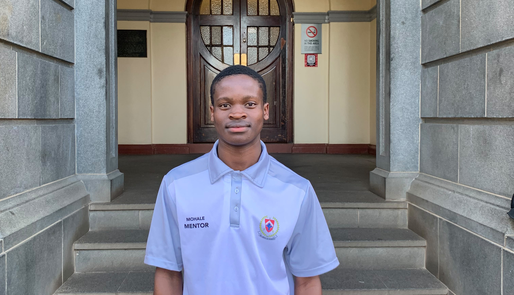

# Hi, I'm Mohale Tomanyana 

**BSc Information Technology (Data Science) Student | Aspiring Data Scientist | Banking Analytics | Quantitative Analysis**

I'm a Data Science student at the **University of the Free State**, interested in applying statistics, programming and mathematical modelling to practical problems, particularly in banking and financial analytics.

I approach every problem with curiosity, discipline and a commitment to understanding beyond the surface. My goal is not simply to develop technical solutions, but to uncover meaningful insights, challenge assumptions and contribute to decisions that create measurable value.

## Education

**University of the Free State**  
BSc Information Technology — Specialisation in Data Science  
2025–2027

- 88.5% first-semester average (2026)
- 80% first-year average (2025)

## Academic Achievements

- 1st place among students enrolled in the Faculty of Natural and Agricultural Sciences — UFS West College Prestige Awards (2026).
- 2nd place in the UFS West College Top 50 overall (2026).
- 2nd place in the Top 10 seniors at Abraham Fischer–Boetapele Residence (2026).
- Second-best matriculant at Khotso Taole Secondary School (2024), with an 84% average.

## Technical Skills

- Programming: C#, R, Python
- Python libraries: NumPy, pandas, Matplotlib, SciPy
- Data: SQL, databases, data analysis, statistical programming
- Web: HTML, CSS, Bootstrap
- Tools: Visual Studio, VS Code, RStudio, Microsoft Office

## Currently Developing
Building practical machine-learning skills in Python, including classification, regression, clustering, data preparation and model evaluation.

## Featured Projects

### [BankPulse](https://github.com/Mohale62/BankPulse)
**Branch Cash Demand & Liquidity Intelligence**

A Python-based banking analytics project that simulates daily cash withdrawals across retail bank branches to investigate cash demand and reserve allocation. Applies statistical inference, Bayesian modelling and Monte Carlo simulation to compare cash reserve policies, balancing withdrawal shortages against the cost of holding excess cash.

Technologies: Python, NumPy, pandas, Matplotlib.

### [DepositSense](https://github.com/Mohale62/DepositSense)
**Retail Deposit Stability & Liquidity Risk Analytics**

A Python-based financial analytics project that examines retail deposit behaviour using simulated account-level data. Applies statistical inference, Bayesian modelling and Monte Carlo simulation to assess deposit outflows, explore liquidity stress scenarios and compare alternative liquidity-buffer strategies.

Technologies: Python, NumPy, pandas, Matplotlib.

## Leadership & Experience

**First-Year Mentor — University of the Free State (2026–Present)**

- Support first-year students with academic and practical questions.
- Help students adapt to university life and access campus resources.
- Explain unfamiliar concepts clearly and patiently.

**Gateway Programme Volunteer — University of the Free State (2026)**

- Welcomed incoming students and helped them transition into university.

## Areas of Interest

- Data Science
- Machine Learning and Artificial Intelligence
- Banking and Financial Analytics
- Quantitative Analysis
- Mathematical Modelling

## Languages

Sesotho | English
## Get in Touch

I'm open to opportunities, professional connections, internships and discussions around data science and financial analytics.

- **Email:** mohaletomanyane520@gmail.com
- **LinkedIn:** [Mohale Tomanyana](https://www.linkedin.com/in/mohale-tomanyana-a96235398)
- **Location:** South Africa, Free State.
---

## My Philosophy

> Every project should begin with a question worth answering, not a technology worth demonstrating.

I believe in using statistics, mathematics and programming to investigate meaningful problems, understand uncertainty and support evidence-based decision-making.
